<!-- SPDX-License-Identifier: GPL-3.0-or-later -->
<p align="center">
  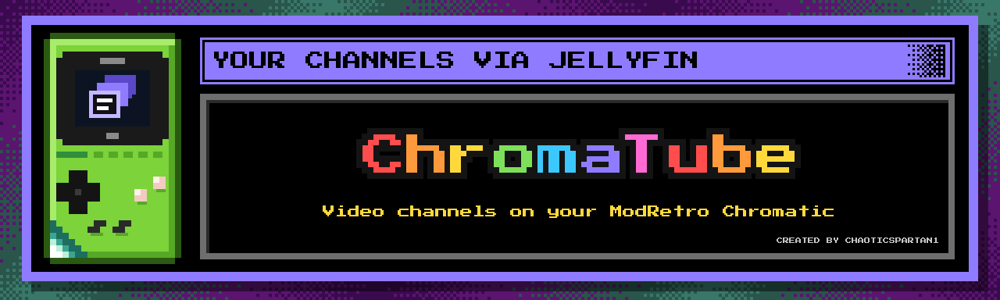
</p>
<p align="center">
  The optional <b>ChromaTube</b> row of the Chromatic's start-up menu: the newest videos of the channels you choose,
  played through <b>your own Jellyfin server</b>.
</p>
<p align="center">
  <b>Read the guide online:</b> <a href="https://chaoticspartan1.github.io/ChromaTube/">chaoticspartan1.github.io/ChromaTube</a>,
  as a PDF: <a href="docs/ChromaTube-Guide.pdf">docs/ChromaTube-Guide.pdf</a> (opens right on GitHub),
  or offline: download and double-click <code>Open-Documentation.html</code>.
</p>

<p><br>
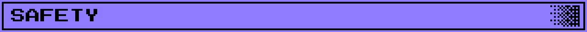</p>

## Safety

> **ChromaTube is an unofficial, independent project, not made, affiliated with or endorsed by YouTube or Google,
> ModRetro, Analogue or the Jellyfin project.** YouTube is a trademark of Google LLC. "ModRetro" and "Chromatic" are trademarks of ModRetro,
> Inc.; "Analogue" and "Pocket" are trademarks of Analogue; "Jellyfin" is a trademark of its owners; they are used here only to say what this project works with.
> **Use it at your own risk.** Support is not guaranteed.

<p><br>
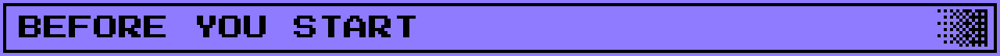</p>

## Before you start: read this

ChromaTube's server side uses **ytdlp2STRM**, a third-party tool built on yt-dlp, to hand your Jellyfin server the
videos of the channels you list. **Tools like this conflict with YouTube's Terms of Service** (they reach videos
outside YouTube's own apps and player). The Chromatic cannot show YouTube's official player, so there is no
permitted way to watch on it. Setting this up is **your own choice, for private use at home**; if you are not
comfortable with that, do not install it. Everything else on the start-up menu works without it.
More: [Before you start](docs/Before-you-start.md).

<p><br>
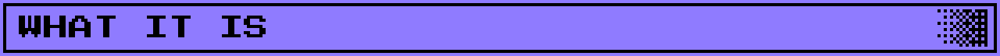</p>

## What it is

ChromaTube is a separate app with its own row on the start-up menu of
[Jellymatic](https://github.com/ChaoticSPARTAN1/Jellymatic). It is built into Jellymatic's start-up menu and is
**off until you switch it on** (Chromatic Manager › Settings › Apps). This repository holds its guide and the server-side set-up.

| Part | What it does |
|---|---|
| **Server tool** (a small container beside Jellyfin) | ytdlp2STRM lists the newest videos (up to 15 each) of the channels in your list, every 6 hours, as tiny `.strm` files in one folder. Nothing is downloaded or kept: a video is fetched only while it plays. |
| **One Jellyfin library, "ChromaTube"** | Jellyfin shows that folder as a library and converts the video you play into the small picture and sound the Chromatic plays, like any film. |
| **The ChromaTube row** (in Jellymatic's start-up menu) | Browse channel › videos, press Play. Uses the console's existing Jellyfin sign-in. |
| **PC tools** (this repository) | Add, check, refresh, test and remove the one library safely; the Docker template and settings. |

<p align="center">
  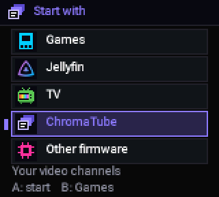
  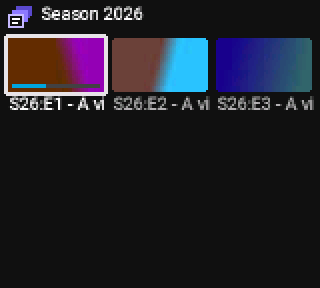
  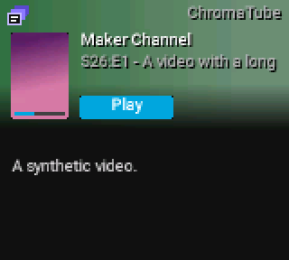
</p>

*All pictures are drawn by the project's own preview renderers with made-up sample data.*

<p><br>
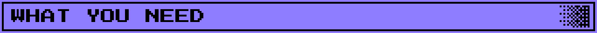</p>

## What you need

- A ModRetro Chromatic with Jellymatic's start-up menu **1.6.5 or newer**, signed in to your Jellyfin server.
- A **Jellyfin server** (10.9 or newer) on your home network, and a machine on that network that runs **Docker**
  (often the same NAS or server), with internet access.
- A folder both the container and Jellyfin can see, **outside your existing libraries**.
- An administrator sign-in, **typed once on the PC** to add the library; the console keeps its own normal user.
- A PC with **Python 3.10+** for the tools. Details: [What you need](docs/What-you-need.md).

<p><br>
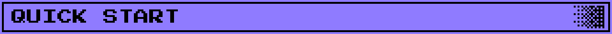</p>

## Quick start (plain English)

Easiest: Chromatic Manager › **Settings › ChromaTube server** writes the server files for you, checks the tool answers
and adds the library (dry run, then Approve); then **Settings › Apps** › ChromaTube on. By hand:

1. **Server tool:** make your copy of the server files with the required page sign-in
   (`py -3 tools\make_server_config.py --host <your Docker machine's LAN address> --out <a folder>`), fill in `.env`
   and `channel_list.json`, firewall port 5005 to your Jellyfin server only (your PC only while checking), copy it to your Docker machine and start
   it (`docker compose -p chromatube up -d`). [Server set-up](docs/Server-setup.md).
2. **Library:** on your PC, `py -3 tools\chromatube_library.py add --server-path <the folder as Jellyfin sees it>
   --ask-admin` (a dry run), then again with `--yes`; then `refresh --yes` and `test`.
   [Add the library](docs/Add-the-library.md).
3. **Watch:** start-up menu › **ChromaTube** › a channel › a video › **Play**.
   [Using ChromaTube](docs/Using-ChromaTube.md).

<p><br>
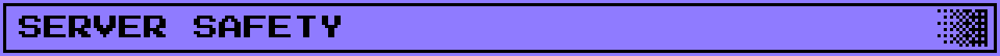</p>

## Your server stays yours

- **Add-only:** one library, on its own folder, with real-time monitoring, internet metadata and picture extraction
  off and no server-wide scan. Every other library is checked byte for byte afterwards.
- **Backup and dry run first;** changes only with `--yes`; `remove` deletes only the library it recorded.
- **The container is boxed in:** pinned image digest, no privilege escalation, 1 GB memory and 1.5 CPU limits, its
  settings mounted read-only, only its own folder mounted, nothing of Jellyfin's, **no YouTube account or cookies**, no
  Jellyfin key.
- **The firewall is the real protection:** port 5005 is **firewalled to your Jellyfin server only** (your PC only while
  you check it). The tool's page **requires a sign-in** (a random one is made for you), but that sign-in guards only
  its settings pages: in the pinned version its command channel has no sign-in and can start programs inside the
  container, so only the firewall keeps others out ([Security](docs/Security.md#what-the-sign-in-does-not-cover)).
- **Your other devices are never signed out;** the tools sign out only their own one-run session and print counts,
  never addresses or names. Full set-up: [Security](docs/Security.md).

<p><br>
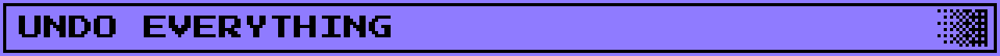</p>

## Undo everything

`py -3 tools\chromatube_library.py remove --yes` removes exactly the library it added (your files are not touched);
`docker compose -p chromatube down -v` stops and deletes the container and its data; delete the ChromaTube folder.
Switch the row off in Chromatic Manager (Settings › Apps) or hide it on the console (Select on the row).
[Undo everything](docs/Undo-everything.md).

<p><br>
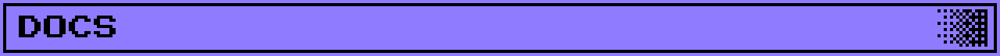</p>

## Documentation (wiki)

Start at **[docs/Home.md](docs/Home.md)**. Pages: What you need · Before you start · Server set-up · Add the library ·
Using ChromaTube · Updating · Security · Undo everything · Troubleshooting · FAQ · Building and testing · Credits &
licences. **As one PDF:** [docs/ChromaTube-Guide.pdf](docs/ChromaTube-Guide.pdf). **Offline:** double-click
**`Open-Documentation.html`** (keep it next to `docs/`).

<p><br>
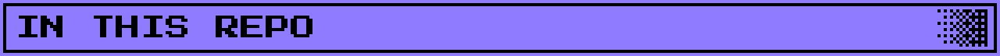</p>

## What is in this repository

```
server/                 docker-compose.yml (pinned digest, limits, read-only settings), .env.example, config.example.json
                        and the tool's other settings templates
tools/                  PC tools: chromatube_library.py, make_server_config.py, jellyfin_admin.py, tests/
art/                    the row's icon (original pixel art, the same pixels as the console's)
docs/                   the guide (Markdown), pictures, fonts, GitHub Pages copy, PDF guide
scripts/                documentation builders and their test
```

**Not in this repository:** ytdlp2STRM, yt-dlp or any video (Docker downloads the pinned image from Docker Hub), any
channel list of anyone's, and the console code: the ChromaTube row is part of Jellymatic's start-up menu
(`chromatic/jellyfin/`, `chromatic/launcher/` in [Jellymatic](https://github.com/ChaoticSPARTAN1/Jellymatic)). Your
own files (backups, the library record) live in `%LOCALAPPDATA%\ChromaTube` and never in Git.

<p><br>
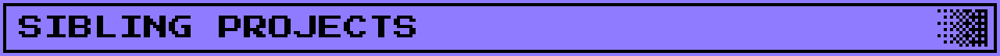</p>

## Sibling projects

- [Jellymatic](https://github.com/ChaoticSPARTAN1/Jellymatic): the Chromatic start-up menu, Jellyfin app and Chromatic Manager (ChromaTube runs inside it).
- [Chromavision](https://github.com/ChaoticSPARTAN1/Chromavision): the TV row, with Local Weather and optional Live TV.
- [PocketFin](https://github.com/ChaoticSPARTAN1/PocketFin): Jellyfin on the Analogue Pocket.
- [RemotePilot](https://github.com/ChaoticSPARTAN1/RemotePilot): see and press the console's menus from your PC.

<p><br>
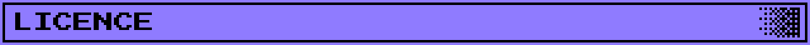</p>

## Licence

ChromaTube is free software: **GPL-3.0-or-later** ([LICENSE](LICENSE)), with additional terms under GPLv3 section 7
([ADDITIONAL-TERMS.md](ADDITIONAL-TERMS.md)): keep the author attribution "ChaoticSPARTAN1" (7(b)) and mark modified
versions as modified (7(c)). ytdlp2STRM (MIT) and yt-dlp (The Unlicense) are not included; see
[THIRD-PARTY-NOTICES.md](THIRD-PARTY-NOTICES.md) and [Credits & licences](docs/Credits-and-licences.md).

<p><br>
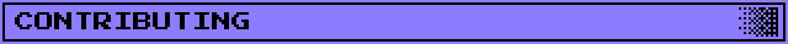</p>

## Contributing and security

Pull requests, bug fixes and bug reports are welcome: [CONTRIBUTING.md](CONTRIBUTING.md). To report a security problem
privately: [SECURITY.md](SECURITY.md). Never post server addresses, tokens, your channel list or logs with addresses.

<p><br>
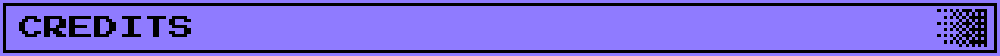</p>

## Credits

Created by **ChaoticSPARTAN1**. The server side uses [ytdlp2STRM](https://github.com/fe80Grau/ytdlp2STRM) by fe80grau
(MIT), which uses [yt-dlp](https://github.com/yt-dlp/yt-dlp) (The Unlicense). Playback by your
[Jellyfin](https://jellyfin.org) server. Full list: [Credits & licences](docs/Credits-and-licences.md).
