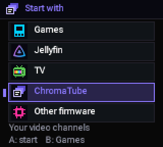
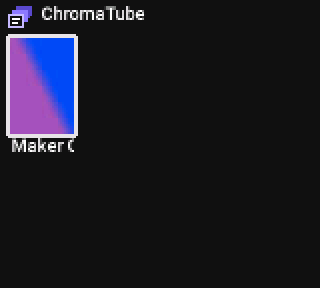

<!-- SPDX-License-Identifier: GPL-3.0-or-later -->
<p align="center"></p>
<p align="center"></p>

# ChromaTube wiki

**Video channels on your ModRetro Chromatic**, played through your own Jellyfin server. Optional, and off until you
set it up.

**Read it as one PDF:** [ChromaTube-Guide.pdf](ChromaTube-Guide.pdf) (opens right on GitHub). **Or offline:**
download or clone the repository, then double-click `Open-Documentation.html` in its main folder.

> ChromaTube is an unofficial, independent project, not affiliated with or endorsed by YouTube or Google, ModRetro,
> Analogue or the Jellyfin project. YouTube is a trademark of Google LLC. Use it at your own risk; support is not guaranteed.
> **Read [Before you start](Before-you-start.md) first.**

## Contents

| Page | Read it when |
|---|---|
| [What you need](What-you-need.md) | Before anything else |
| [Before you start](Before-you-start.md) | Always: the terms question, what it costs your server, what others can see |
| [Server set-up](Server-setup.md) | You start the small server tool |
| [Add the library](Add-the-library.md) | You add the one ChromaTube library to Jellyfin |
| [Using ChromaTube](Using-ChromaTube.md) | Buttons and what the screens say |
| [Updating](Updating.md) | Videos stop playing, or you change channels |
| [Security](Security.md) | You want the server side locked down properly |
| [Undo everything](Undo-everything.md) | You want it all gone |
| [Troubleshooting](Troubleshooting.md) | Something does not work |
| [FAQ](FAQ.md) | Short answers |
| [Building and testing](Building-and-testing.md) | You change the tools or the docs |
| [Credits & licences](Credits-and-licences.md) | Who made what, and under which licence |

## In one picture

```
 your channel list ──► ytdlp2STRM container ──► one folder of tiny .strm files ──► Jellyfin library "ChromaTube"
 (on the Docker machine)   every 6 hours           (nothing is downloaded)            converts the one video you play
                                                                                                 │ Wi-Fi
 Start-up menu ──► ChromaTube ──► channel ──► video ──► Play ◄───────────────────────────────────┘
```

<p align="center">
</p>
