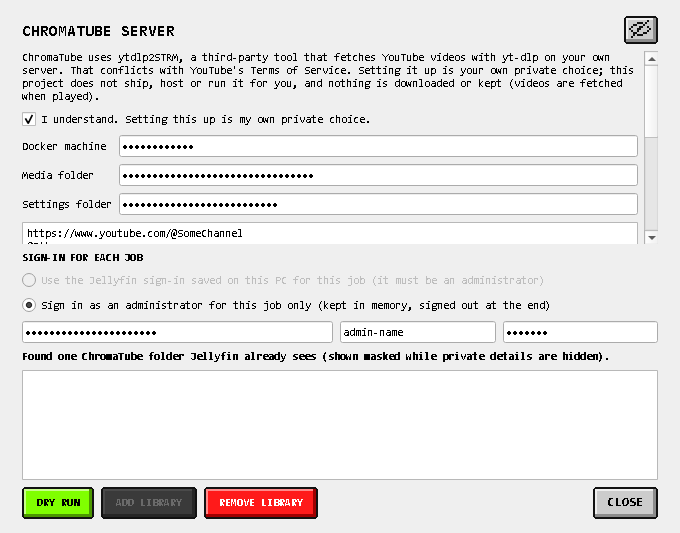
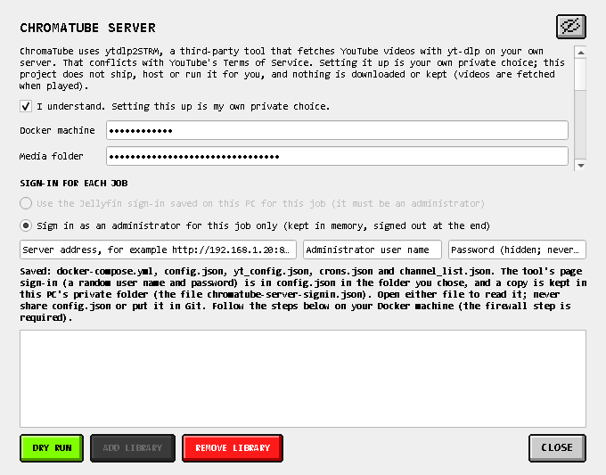

<!-- SPDX-License-Identifier: GPL-3.0-or-later -->
# Server set-up

[Home](Home.md) › Server set-up

**Contents:** [1. Choose the folder](#1-choose-the-folder) · [2. Make your copy of the files](#2-make-your-copy-of-the-files) ·
[3. Your channels](#3-your-channels) · [4. Close port 5005 to everyone else](#4-close-port-5005-to-everyone-else) ·
[5. Start it](#5-start-it) · [6. Check it](#6-check-it)

**The easy way: Chromatic Manager.** **Settings › ChromaTube server** (text menu `y`; tick "I understand" first):

1. Fill in your Docker machine's home-network address, a **media folder** on that machine that your Jellyfin container
   can already see (but **not** inside one of your library folders: then Jellyfin needs no restart and no new mount),
   the folder where you keep the settings files, and your channels (one a line, like `https://www.youtube.com/@name`).
2. **Save files...** writes `docker-compose.yml` and four settings files into a folder you choose on your PC.
   `config.json` gets the tool's **page sign-in**, which is **required**: a random user name and password that Chromatic
   Manager makes for you. It is stored only in `config.json` and in a private copy on your PC (Chromatic Manager's file
   `chromatube-server-signin.json`); the window never shows it (open either file if you need to read it). Saving again
   keeps the same sign-in. Never share `config.json` or put it in Git. Copy the five files to the settings folder on the
   Docker machine.
3. **Required:** on the Docker machine's firewall, allow port **5005** only from your Jellyfin server; allow your PC
   only while you run **Check it answers** or open the tool's page, then remove that rule. Never forward 5005 on your
   router. The firewall is the real protection: the sign-in guards only the settings pages
   ([Security](Security.md#what-the-sign-in-does-not-cover)).
4. In your Docker app, create a project named `chromatube` from `docker-compose.yml` (or run
   `docker compose -p chromatube up -d` in that folder). The Manager never runs Docker for you.
5. **Check it answers**: it passes only when the tool's page **refuses** a visitor without the sign-in and **answers**
   with it (the private copy on your PC). If it says the tool answers without a sign-in, copy the saved `config.json` to
   the Docker machine again and restart the project.

Then add the library on the same page ([Add the library](Add-the-library.md)). The Manager writes the same safety
settings as `server/` here (pinned digest, no privilege escalation, settings mounted read-only, no cookies, no Jellyfin
key) and never runs Docker for you.

<p align="center">
</p>

**By hand:** the steps below. The server tool is a small Docker container (ytdlp2STRM) beside your Jellyfin server.
You start it yourself: neither the tools here nor Chromatic Manager ever control your Docker.

## 1. Choose the folder

Pick **one** folder for the video list that:

- the Docker machine can write to, and
- your **Jellyfin server can already see**, and
- lies **outside every existing library folder** (otherwise another library would scan it).

Note two paths: where it is **on the Docker machine** (for `.env`) and where **Jellyfin** sees it (for the library,
for example `/config/ChromaTube` when Jellyfin runs in Docker with its configuration folder mounted at `/config`).
If Jellyfin cannot see any such folder yet, adding a new mount to the Jellyfin container means re-creating it (a
restart): decide that yourself; ChromaTube never does it.

## 2. Make your copy of the files

Never fill in the files inside the cloned repository: `config.json` will hold a password. Make your own copy,
**with the tool's page sign-in set. The sign-in is required**: the tool's page can change its settings, so without a
sign-in anyone on your home network who can reach port 5005 could do that. The sign-in guards only the settings
pages, not the tool's command channel: the firewall rule in step 4 is the real protection.

```
py -3 tools\make_server_config.py --host 192.168.1.20 --out D:\chromatube
```

`--host` is the Docker machine's **LAN address** (the address Jellyfin uses to reach it; never `0.0.0.0`, never a
public address). It copies the files of `server/` into the new folder and writes `config.json` with that address and a
**random user name and long random password** for the page (open `config.json` to read them; they are never printed).
On macOS/Linux the files are readable by you only (if the tool later cannot read its settings, check the file's owner
and permissions on the Docker machine). Copy that folder to the Docker machine (for example as
`chromatube/`), then:

| File | What to do |
|---|---|
| `.env.example` → `.env` | Set `CHROMATUBE_LIST_FOLDER` to the folder from step 1, as the Docker machine sees it |
| `config.json` | Already filled in. By hand instead: copy `config.example.json` to `config.json` and replace **every** `CHANGE-ME`: the LAN address, a user name and a long random password of your own. Never leave the sign-in empty; never commit or share this file |
| `channel_list.json` | Your channels (step 3) |
| `yt_config.json`, `crons.json` | Leave as they are: 360p sources, at most 15 videos a channel from the last 30 days, a new list every 6 hours, **no cookies**, no Jellyfin key |
| `docker-compose.yml` | Leave as it is: the image is pinned by digest, no privilege escalation, limits set, and the four settings files **mounted read-only** |

**Read-only settings:** the container cannot change its own settings files, so the page cannot change its sign-in or
your channels. To change anything, edit the file on the Docker machine, then restart:
`docker compose -p chromatube restart`.

## 3. Your channels

`channel_list.json` is a list of channel addresses, one per line, for example:

```
[
    "https://www.youtube.com/@SomeChannel",
    "https://www.youtube.com/channel/UCxxxxxxxxxxxxxxxxxxxxxx"
]
```

Keep it short (a handful of channels is plenty on a handheld). The list stays on your Docker machine.

## 4. Close port 5005 to everyone else

This step is **required**, not optional:

- **No port forward** for 5005 on your router.
- On the Docker machine's firewall, allow port 5005 **only from your Jellyfin server**; block it for every other
  device. Allow your PC only while you run **Check it answers** or open the tool's page, then remove that rule.
- **This rule is the real protection.** In the pinned version the page sign-in protects the settings pages only: the
  tool's live command channel has no sign-in, accepts connections from any web page and can start programs inside the
  container, so anything that can reach port 5005 (including a web page open in a browser on an allowed computer)
  could use it. The video addresses Jellyfin uses (`/youtube/...`) need no sign-in either.
- Details: [Security](Security.md#what-the-sign-in-does-not-cover).

## 5. Start it

In the folder with `docker-compose.yml`:

```
docker compose -p chromatube up -d
```

Or, in a NAS Docker app: new project, name `chromatube`, paste `docker-compose.yml`, put the other files in the
project folder, start it. The container is called `chromatube-ytdlp2strm`. Its page answers at
`http://<the address in config.json>:5005` and asks for the user name and password from `config.json`.

Why "host" networking: this version of the tool listens only on the address written in `config.json`, and with
Docker's default bridge network its page cannot be reached. Because it binds to that one LAN address, it is not
listening on other interfaces of the machine.

If the container does not start with the hardening settings (read-only settings, no privilege escalation), look at
its log (`docker logs chromatube-ytdlp2strm`) and report it ([CONTRIBUTING.md](../CONTRIBUTING.md)); do not remove the
sign-in or open the port to work around it. If the log says it cannot read `config.json`, check that file's owner and
permissions on the Docker machine.

## 6. Check it

- Open its page from your PC (with the temporary firewall rule for your PC): it asks for the sign-in, then lists your
  channels and its next run. Remove the PC's rule again when you are done.
- After the first run (start it from its page, or wait up to 6 hours), the ChromaTube folder holds one folder per
  channel with `.strm` files.

Next: [Add the library](Add-the-library.md)
