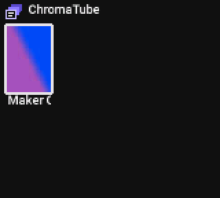
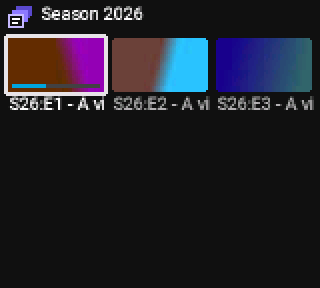
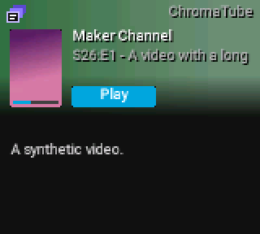
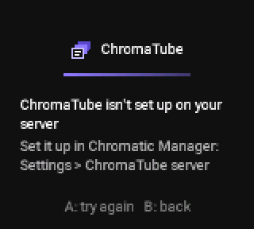
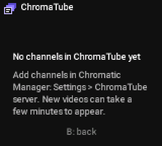
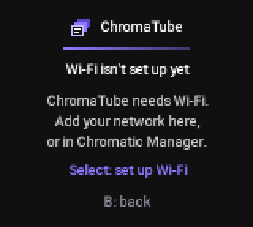

<!-- SPDX-License-Identifier: GPL-3.0-or-later -->
# Using ChromaTube

[Home](Home.md) › Using ChromaTube

**Contents:** [Browsing](#browsing) · [Playing](#playing) · [What the screen says](#what-the-screen-says) · [Limits](#limits)

## Browsing

Switch it on first (Chromatic Manager › Settings › Apps). Start-up menu › **ChromaTube** › **A**. The console joins your Wi-Fi, signs in with its own Jellyfin sign-in and opens
the library named ChromaTube: your channels, then each channel's videos (grouped by year, like seasons), then a
video's page with **Play**.

| Button | Does |
|---|---|
| D-pad | Move |
| **A** | Open / Play |
| **B** | Back; at the channels, back to the start-up menu |
| **Select** (on the start-up menu's ChromaTube row) | Asks "Hide ChromaTube?" (bring it back: Other firmware › Show hidden apps) |

## Playing

**Play** asks your server to prepare the video first (Jellyfin's PlaybackInfo), then plays it as one stream from the
beginning at up to 500 kbit/s and 15 pictures a second, with sound (console chip image 18.40 or 18.41). The first
picture takes a few seconds: the server tool fetches the video's address first.

- **A** or **Start** pauses and plays; **Select**, Up or Down show or hide the bar under the picture; **B** stops.
  Left/Right and the Menu button do nothing during a ChromaTube video.
- There is **no seeking, no resume and no quality change** on ChromaTube videos: they always start from the
  beginning. A dropped connection stops the video and says so.
- Jellyfin records what you watched, as for any video.

## What the screen says

| Message | Means |
|---|---|
| **Wi-Fi isn't set up yet** | ChromaTube needs Wi-Fi: **Select** sets it up on the console, or use Chromatic Manager |
| **ChromaTube isn't set up on your server** | There is no library named exactly "ChromaTube", or the console's user cannot see it ([Add the library](Add-the-library.md)) |
| **No channels in ChromaTube yet** | The library is there but empty: add channels, wait for the tool's next run (new videos can take a few minutes), then refresh the library ([Updating](Updating.md)) |
| A video does not start | The server tool could not fetch it (see [Updating](Updating.md) and [Troubleshooting](Troubleshooting.md)) |

## Limits

- **Play ChromaTube videos from the ChromaTube row.** The library also shows in the Jellyfin row, but a ChromaTube
  video opened there plays full size without sound (the Jellyfin row does not ask PlaybackInfo first).
- The Analogue Pocket (PocketFin) is not supported for ChromaTube videos.
- Only the channels in your list, at most 15 recent videos each; new videos appear after the tool's next run and
  Jellyfin's next scan of the library.
- Long titles are cut.

Next: [Updating](Updating.md)
